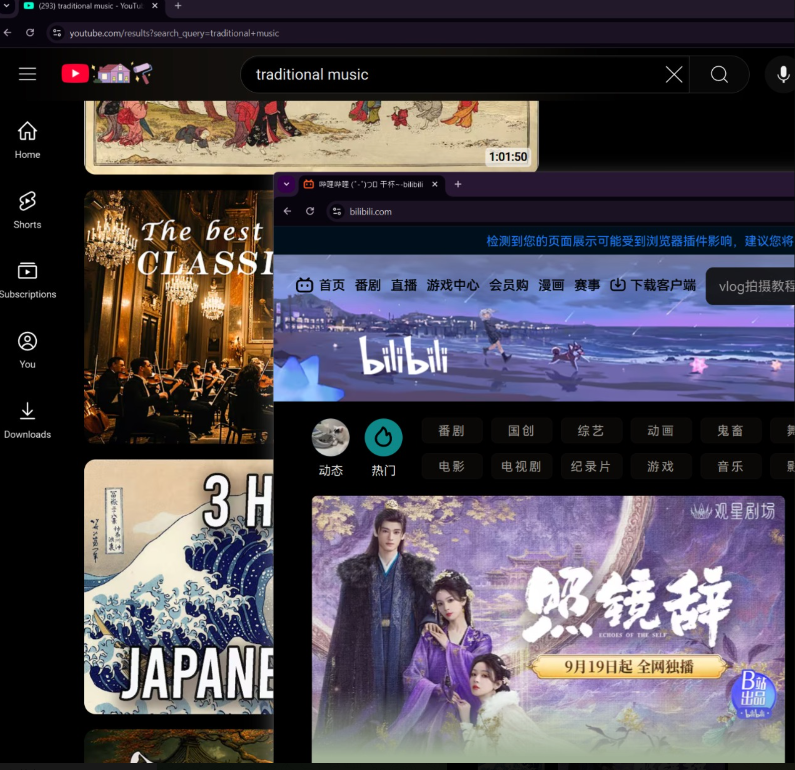

# Media Color Invert

A userscript that toggles CSS color filters for images, videos, and SVGs with **Alt + i**. It is intended to complement an inverted screen color filter, so media can retain its natural colors while the surrounding interface appears dark.



## Installation

1. Install a userscript manager that supports the asynchronous `GM.getValue` and `GM.setValue` APIs.
2. [Install the userscript](https://github.com/snomiao/media-color-invert/raw/main/media-color-invert.user.js).
3. Confirm the installation in your userscript manager.

The script matches HTTP and HTTPS pages. Your browser and userscript manager must allow it to run on the page; browser-internal pages are outside that match.

## Usage

Press **Alt + i** to toggle the filter. Ctrl, Shift, and the Command/Meta key must not be held with the shortcut.

The preference is stored under the single `media-color-invert` key in userscript storage. It is shared by the script across sites, rather than stored separately for each website, and defaults to off. Open tabs apply the preference when toggled or when they regain focus.

For use with Windows screen inversion, first configure an inverted color filter and enable its keyboard shortcut in Windows accessibility settings. **Ctrl + Windows + C** toggles the configured screen filter; **Alt + i** toggles this script's additional page filters. The script itself does not change Windows settings.

## How it works

When enabled, the script inserts a style element with these rules:

```css
.body {
  filter: hue-rotate(180deg);
}
video, img {
  filter: invert(1);
}
svg:not(:has(svg)) {
  filter: hue-rotate(180deg);
}
```

`.body` matches a CSS class, not the HTML `body` element. A hue rotation changes hues; it is not a full brightness inversion. The result depends on the page's own styling and any screen-level color filter.

The script checks its setting at startup, on window focus, and after the shortcut. The CSS selectors also apply to newly inserted matching elements. There is no active DOM mutation observer or debounced scan loop.

## Requirements and limitations

- The userscript requests `GM.getValue` and `GM.setValue` for preference storage and runs at `document-start`.
- It needs a page with an available `document.head` when inserting its style. If initialization happens too early, focus the page again to trigger another check.
- SVG filtering uses the CSS `:has()` selector, which requires browser support.
- Filters target matching elements in the document. Content inside shadow roots and page-specific filter rules can behave differently; compatibility with every website is not guaranteed.
- Script version: **1.1.0**. This README update does not change runtime behavior.

## Contributing and support

[Report a bug or suggest an improvement](https://github.com/snomiao/media-color-invert/issues), including your browser, userscript manager, and a reproducible example. Documentation improvements and pull requests are welcome.

## License

[MIT](LICENSE).
