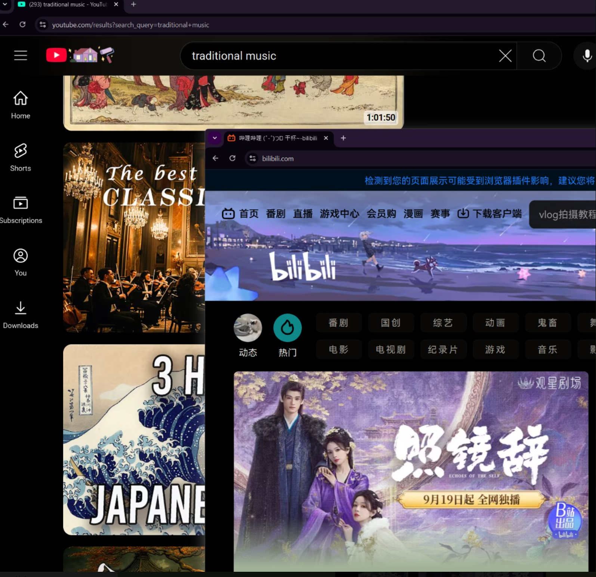

# Media Color Invert

A browser userscript that provides intelligent color inversion for images and videos on web pages. Perfect for night browsing and reducing eye strain, especially when used with Windows' built-in color inversion feature.

## Features

- **Quick Toggle**: Press `Alt + i` to instantly invert colors of all media elements on the page
- **Smart Inversion**: Inverts images and videos while maintaining correct colors for other elements
- **Persistent Settings**: Remembers your preference per website across browser sessions
- **Lightweight**: Minimal performance impact with debounced scanning
- **Universal Compatibility**: Works on all websites
- **Windows Integration**: Designed to complement Windows' `Ctrl + Windows + C` screen color inversion

## Installation

### Prerequisites
- A userscript manager extension:
  - [Tampermonkey](https://www.tampermonkey.net/) (Chrome, Firefox, Safari, Edge)
  - [Greasemonkey](https://www.greasespot.net/) (Firefox)
  - [Violentmonkey](https://violentmonkey.github.io/) (Chrome, Firefox, Edge)

### Install Steps
1. Install a userscript manager in your browser
2. Click [here to install](https://github.com/snomiao/media-color-invert/raw/main/media-color-invert.user.js)
3. Your userscript manager will prompt you to install the script
4. Confirm the installation

## Usage

### Basic Usage
- Press `Alt + i` on any webpage to toggle color inversion for images and videos
- The setting is saved automatically and will be remembered when you revisit the page

### Perfect Dark Mode Setup (Windows)
For the ultimate dark mode experience:

1. **Enable Windows Color Inversion**: Press `Ctrl + Windows + C` to invert your entire screen
2. **Use This Script**: Press `Alt + i` on web pages to re-invert images and videos back to their natural colors
3. **Result**: You get a true dark mode where:
   - All UI elements are inverted (dark backgrounds, light text)
   - Images and videos appear in their original colors
   - Perfect for night browsing and reducing eye strain

## How It Works

The script applies CSS filters to achieve color inversion:

- **Page Content**: Uses `hue-rotate(180deg)` to invert the overall page colors
- **Media Elements**: Applies `filter: invert(1)` to images and videos to restore their natural appearance
- **SVG Elements**: Handles SVG graphics separately to preserve their appearance

## Technical Details

- **Version**: 1.1.0
- **Namespace**: snomiao@gmail.com
- **Permissions**: Uses `GM.getValue` and `GM.setValue` for preference storage
- **Execution**: Runs at `document-start` for optimal performance
- **Compatibility**: Works with all modern browsers

## Contributing

Contributions are welcome! Please feel free to:

- Report bugs or issues
- Suggest new features
- Submit pull requests
- Improve documentation

## Support

- [Report Issues](https://github.com/snomiao/media-color-invert/issues)
- [Donate](https://snomiao.com/donate)

## License

MIT License - See [LICENSE](LICENSE) file for details

## Author

- **snomiao** - [snomiao@gmail.com](mailto:snomiao@gmail.com)
- **GitHub**: [snomiao](https://github.com/snomiao)
